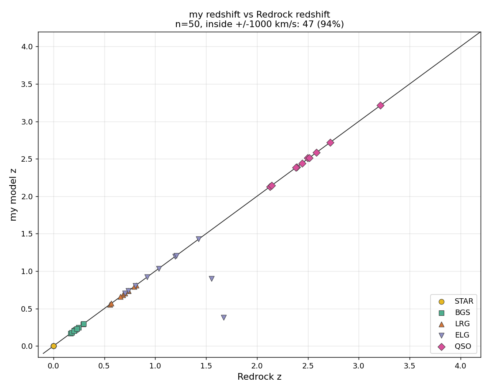
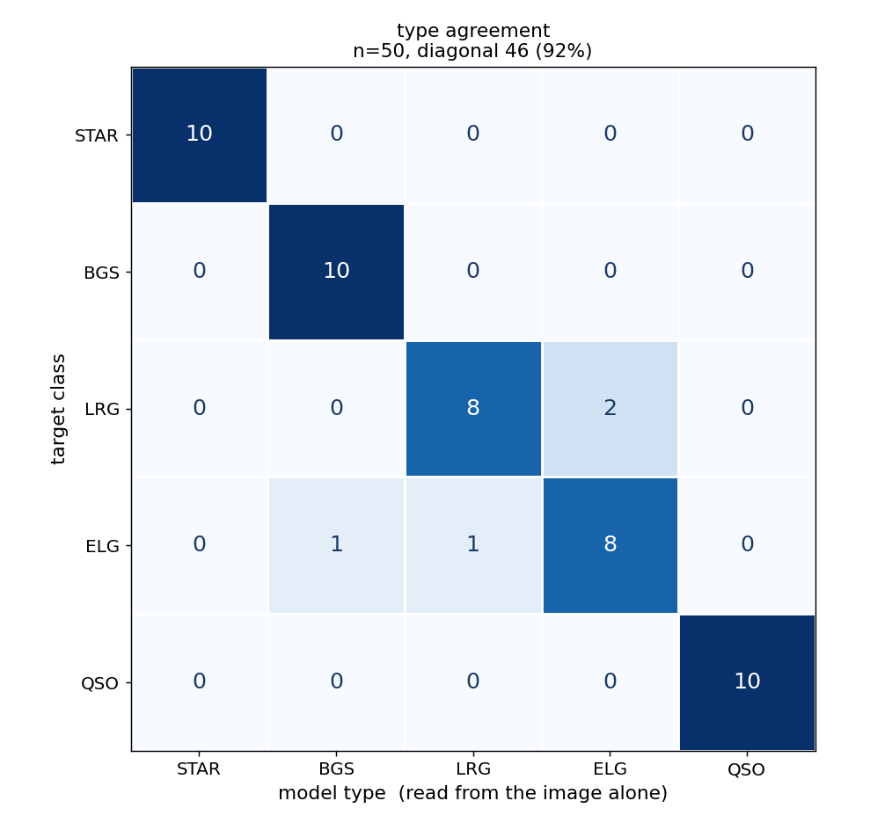
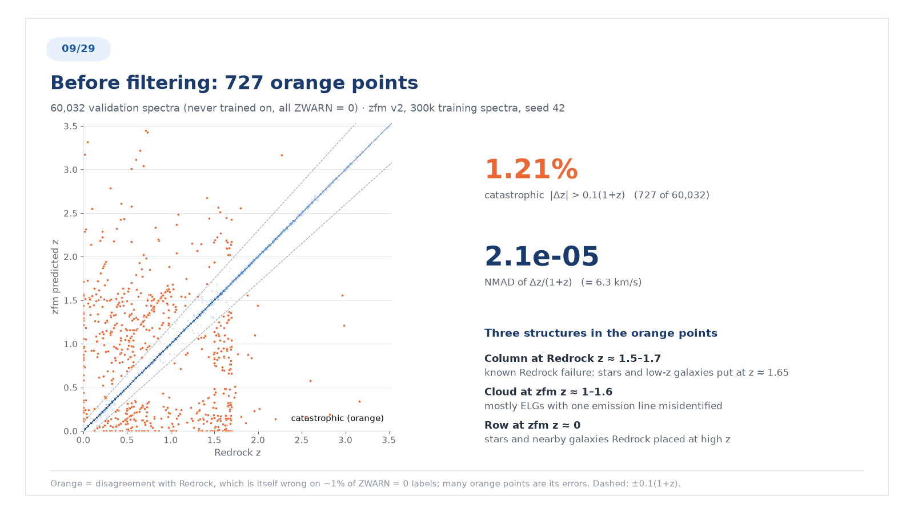
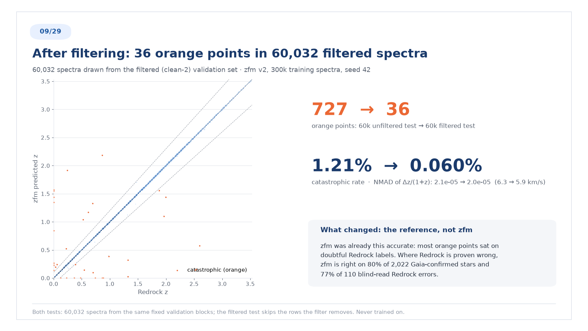

# Measuring redshift from DESI spectra, without Redrock

Determining spectroscopic redshift and object type from **flux and inverse
variance alone** — and, just as much, learning when the answer cannot be
determined and should be refused.

The type is read from an unlabelled image of the spectrum. That reading then
selects which template family is fitted, and the fit gives the redshift.

---

## Start here

**[`METHOD.md`](METHOD.md)** describes how the type is read and the redshift
is measured. Each rule comes with the measurement behind it, along with the
negative results and what was tried and rejected.

**[`RULE.md`](RULE.md)** records what is enforced, and in code, and the
corrections log traces every rule to the error that bought it. It is **not** a
checklist to read before judging a spectrum. Reading it first was measured to
spread a wrong rule more than reading without it did.

**[`DESIGN.md`](DESIGN.md)** describes the model being built (zfm). That covers
its architecture, loss, and evaluation, plus how its training labels are
cleaned. Every constraint carries the measurement that forces it.

## Results

Nine sealed blind tests on fresh DESI DR1 spectra — 400 spectra, no target
ever repeated across cohorts. In each, the reference redshifts and types were written to a
file at mode 600 during the build and opened **once**, after every call was
already on disk.

Tests IV–IX are `main`; tests X–XIII are on `SV3`, a deeper survey. The
median depth ratio (TSNR2) is 1.29× for ELG and LRG, 1.77× for BGS and 2.23×
for QSO; only its deepest tail reaches 2–4×. The SV3 columns are therefore not
directly comparable to the `main` ones and are kept in a separate table.

| | IV | V | VI | VII | VIII | IX | tests VI–IX |
|---|---|---|---|---|---|---|---|
| spectra | 100 | 50 | 50 | 50 | 50 | 50 | **200** |
| redshift within ±1000 km/s | 95/100 | 47/50 | 48/50 | 46/50 | **50/50** | 47/50 | **191/200** |
| redshift within \|Δz\| < 0.1 | — | — | 50/50 | 49/50 | 50/50 | 48/50 | **197/200** |
| type, 5-way vs target class | 89/100 | 46/50 | 47/50 | 45/50 | 43/50 | **49/50** | 184/200 |
| **type, 3-way vs `SPECTYPE`** | 98/100 | 50/50 | 50/50 | 48/50 | 49/50 | **50/50** | **197/200** |
| the target bits, same comparison | 99/100 | 50/50 | 50/50 | 46/50 | 47/50 | 50/50 | **193/200** |

### SV3 — four tests, 200 spectra

| | X | XI | XII | XIII | all four |
|---|---|---|---|---|---|
| spectra | 50 | 50 | 50 | 50 | **200** |
| redshift within ±1000 km/s | 48/50 | 49/50 | 43/50 | 44/50 | 184/200 |
| redshift within \|Δz\| < 0.1 | **50/50** | 49/50 | 43/50 | 44/50 | **186/200** |
| type, 5-way vs target class | 47/50 | 47/50 | 42/50 | 41/50 | 177/200 |
| **type, 3-way vs `SPECTYPE`** | **50/50** | **50/50** | 44/50 | 44/50 | **188/200** |
| the target bits, same comparison | 50/50 | 49/50 | 45/50 | 42/50 | 186/200 |

Test XIII was read with `RULE.md` deliberately **not** re-read beforehand, to
see what the checklist was carrying rather than what the reader had absorbed.
It scored the same as test XII, which was read with the checklist open, so the
drop from X and XI is not the checklist's absence. It is the **selection**:
tests XII and XIII were built with `--zmax 1.6`, X and XI without one. Under no
cut, all 20 QSO targets are quasars at z = 1.61–2.50 with three or four broad
UV lines in the window, and they were read 20/20. Under the cut the QSO targets
are 9 quasars, 7 stars and 4 galaxies at z ≤ 1.46, and the surviving quasars
have one or two lines. Errors fall 5 of 10 QSO targets against 2 of the other
40. Grouped by lines in the window: **4 lines 9/9, 3 lines 13/14, 2 lines 3/5,
1 line 0/4.** Both of test
XIII's type failures were caught afterwards by a guard that now refuses to run:
the strongest line filter peaked above 8σ at a wavelength the candidate record
never mentioned.

**Two redshift criteria, because they measure different things.** ±1000 km/s
is the standard catastrophic-failure threshold and is a statement about
precision; \|Δz\| < 0.1 is roughly 20,000 km/s at z = 0.5 and is a statement
about *identification* — did the right object, at roughly the right distance,
come out. Under the looser bar the score is **197/200**, and five of the six
newly-forgiven cases are quasar systemic offsets of 1100–1900 km/s, which were
never misidentifications: broad lines are blueshifted by outflows relative to
the systemic redshift. The sixth, OBJ034 at \|Δz\| = 0.098, is a genuine line
misidentification that happens to land 2% inside the bar — the loose criterion
is not a clean misidentification detector either.

Of the three that fail both criteria, **two are the reference being wrong**
(see *The reference has an error rate of its own* in `METHOD.md`). That leaves
one genuine catastrophic error in 200 objects, OBJ044, where the template fit
chose a solution whose 4000 Å break measures −0.5σ over one measuring 5.5σ.

The target-bit row is the other one to read. The DESI photometric target bit is a
prediction of what the object is, made before any spectrum existed. Over the
200 objects of tests VI–IX it agrees with Redrock's spectroscopic
classification **193** times; reading the picture agrees **197** times. A
large share of the 5-way "type errors" are therefore the target bit being
wrong, not the reading.

  
  

**Part V is exact on the three-way classification** — every one of the fifty
gets the same STAR / GALAXY / QSO type Redrock assigns.

**BGS went from 13/20 to 10/10** between the two tests, from one change:
BGS-vs-LRG is a redshift cut (z ≈ 0.42, worth 92.6% over 20,000 objects), not
something visible in a spectrum, so it is assigned *after* the redshift is
measured instead of guessed from the break position. The BGS↔LRG cell that
dominated Part IV's errors is now empty.

Of Part V's three redshift misses: one is a true information limit (every line
past the 9824 Å edge), one is a 1226 km/s quasar near-miss against a 1000 km/s
mark — not a misidentification — and one is a **23σ line I mistook for a sky
residual**.

---

## Which Redrock redshifts to trust: cleaning the training labels

zfm is trained on Redrock redshifts, and about 1% of `ZWARN == 0` labels are
wrong. A model that learns them copies them. `code/rrwrong/` learns to say
when a Redrock redshift is wrong, and the training data is rebuilt without the
labels it distrusts. The full record is in
[`DESIGN.md` §6d-3](DESIGN.md#6d-3-clean-v2-a-learned-redrock-error-filter-owner-2026-09-28).

- **Truth it learns from.** DESI EDR visual inspection, 18,653 targets
  (Lan et al. 2022, arXiv:2208.08516; Alexander et al. 2022, arXiv:2208.08517),
  with Redrock re-run at SV1 per-night depth, which is close to main-survey
  depth.
- **Inputs.** Redrock's own fit quality (DELTACHI2, χ²/pixel, ZERR, template
  coefficients, z, SPECTYPE), imaging photometry, Gaia, and the target bits.
- **Checked against data it never saw.** Each test compares the model with
  DELTACHI2 alone, keeping the same number of rows:

  | test | DELTACHI2 alone | rrwrong |
  |---|---|---|
  | 1.0M main targets on two tiles: wrong-pair rate | 0.73% | 0.16% |
  | 2,022 Gaia-confirmed stars Redrock placed at z > 0.1: removed | 31% | 100% |
  | 110 blind-read Redrock errors: removed | 14% | 78% |

- **The clean-2 training set** removes a row if any of three rules holds: a
  repeat observation disagrees or Gaia says it is a star; DELTACHI2 < 25; or
  P_WRONG > 0.01. It deletes 6.6% of main (17.43M rows kept). The backup
  program is exempt: no inspected spectra cover it, and there the model
  flagged 72% of Gaia-confirmed stars.

Scored on 60,032 validation spectra, zfm disagrees with Redrock on 727
(1.21%). On a fresh 60,032 drawn from the filtered set it disagrees on 36
(0.060%), and NMAD of Δz/(1+z) stays 2.0e-05. **What changed is the
reference, not zfm.** Most of the disagreements sat on doubtful Redrock
labels. Where Redrock is proven wrong, zfm is right on 80% of the
Gaia-confirmed stars and 77% of the blind-read errors.

  
  

The rule-by-rule breakdown and the per-class figures (STAR, BGS, LRG, ELG,
QSO) are in `figures/clean2_s3_filter.png`, `clean2_s4_before_by_class.png`
and `clean2_s5_after_by_class.png`.

---

## What's here

| path | what it is |
|---|---|
| **[METHOD.md](METHOD.md)** | how the type is read and the redshift is measured — start here |
| **[report/redshift_report.html](report/redshift_report.html)** | the full report, 36 sections, 24 figures. Open in a browser |
| `DESIGN.md` | **the model to be built**: architecture, loss, refusal and evaluation, each constraint carrying the measurement that forces it; §6d covers training-label cleaning |
| `RULE.md` | what is enforced and the corrections log (a record, not a pre-read checklist) |
| `report/redshift_report.ipynb` | the same, executed, with all code |
| `figures/` | `c2_*`, `c3_*`: blind-test headline figures; `clean2_*`: the label-cleaning results |
| `code/` | the measurement path and the blind-test tooling |
| `code/rrwrong/` | the learned Redrock-error filter, its validation, and the clean-2 builder (see its README) |

### Code

| file | role |
|---|---|
| `speclib.py` | official BRZ camera coaddition; continuum, significance and break statistics; rendering |
| `engine.py` | the FFT redshift scan — redshift is a pure translation in ln λ, so one transform covers every z |
| `templates.py` | per-class template families and their redshift ranges |
| `methodc.py` | two-stage fit: candidate generation, then decision on a common data vector |
| `d4000.py` | 4000 Å break candidate generation |
| `make_cohort.py` | builds a blind cohort and writes the sealed key |
| `make_cohort_h5.py`, `h5pick.py` | the same from the DR1 BRZ h5 files ("sv3" → SV3 file, otherwise main), with non-repeating draws |
| `measure3.py` | fits the family the visual call selected; the call is five-way (STAR / BGS / LRG / ELG / QSO), a trailing `?` marks a guess |
| `final3.py` | opens the sealed key once, scores, draws the figures |
| `zoom.py` | four-width diagnostic for spectra too faint to read from flux |
| `check.py` | asserts the cohort invariants; exits non-zero if broken |
| `slideguard.py` | refuses figure text that breaks a reporting rule |
| `scaling.py` | FLOP cost and run plan for the scaling-law fit |

---

## The blind protocol

No Redrock information reaches selection, inputs or figures, with one declared
exception noted below. That excludes `Z`, `SPECTYPE`, `DELTACHI2`, and the
`ZCAT_PRIMARY` / `MAIN_PRIMARY` dedup flags — those rank *by* `ZWARN` and would
smuggle Redrock's confidence ordering in through the selection. Those values
appear only when scoring work that is already finished.

- **selection columns**: `TARGETID`, `SURVEY`, `PROGRAM`, `HEALPIX`,
  `COADD_FIBERSTATUS`, `DESI_TARGET`, `TSNR2_*`, and `ZWARN` as a `== 0` filter
  only
- **filters**: `SURVEY=="main"`, `TARGETID>0`, `COADD_FIBERSTATUS==0`,
  `ZWARN==0`
- **class**: `DESI_TARGET` bits, priority QSO(2) > LRG(0) > ELG(1) >
  BGS_ANY(60) > MWS_ANY(61)=STAR. These are *photometric target classes*, not
  spectroscopic truth — what the spectrum turns out to be is a finding
- **repeated TARGETIDs**: keep the highest `TSNR2_<class>` row
- **SNR**: measured from the spectrum, `median(|flux|·√ivar)` — never `TSNR2`,
  which describes the observation and not the object
- **renders**: an opaque id and nothing else, shuffled across classes

### The one exception: `ZWARN == 0`

From 2026-09-02 every cohort selects only objects with `ZWARN == 0`. This is a
deliberate hole in the rule above, and it is worth being explicit about both
halves of it.

The reason is that a score is meaningless against an answer key that has
disowned its own number. `ZWARN != 0` is Redrock flagging its own redshift as
unreliable, so a disagreement there is two uncertain answers disagreeing, not a
measurement of the reader. The n = 50 test below contains exactly this case:
OBJ011 is counted as a 144,966 km/s failure against a reference carrying
`ZWARN 4`.

The cost is that this is not a random cut. `ZWARN != 0` concentrates on faint,
high-redshift, feature-poor spectra — the hardest objects — so filtering them
out removes hard cases by construction and makes every later cohort easier in a
way the score does not show. **A result from such a cohort must be read as "of
objects Redrock is confident about", never as a result over DESI as a whole.**

Tests IV and V predate the rule and were not filtered this way; `code/check.py` reports their `ZWARN != 0` counts (3 of 100 and 1 of 50)
without failing them, and holds later cohorts to the rule via the
`data/selection_rules.json` each build writes.

---

## Things worth knowing before reading the report

**"SNR" names three different quantities.** `TSNR2` is a property of the
*observation*; SNR per pixel is how *bright the object* is; feature significance
decides whether the redshift is *measurable*. `TSNR2` correlates with how bright
a star is at **−0.002** — exactly zero, because exposure depth cannot change
that. The survey equalises *evidence*, not photons: in dark time an LRG's
per-pixel SNR halves while its break significance is unchanged, and the extra
exposure buys distance (median z 0.41 → 0.81) rather than precision.

**Different classes carry the redshift in structurally different places.** Half
of an ELG's redshift information lives in **7 pixels** of 7781; an LRG needs
**1425**. That is a difference in kind, not difficulty, and it is why one
instrument cannot serve both — a line filter on an LRG returns 3.9σ, a break
statistic on an ELG returns 1.4σ.

**The 4000 Å break is a shape, not a feature.** A local-step detector finds it
1% of the time and locks onto Hα or Na D instead; reading the whole continuum
shape by eye beat it 8:1.

**Every remaining error is discrete.** Correct answers sit 1.9–2.9 σ_z from the
truth; wrong ones are 3,470–13,362 σ_z away, and **not one error in 12,000 falls
within 5σ_z**. The two populations do not overlap, so the remaining problem is
*which peak*, not *how precisely*.

---

## Status and honest limits

- The blind tests are small. Each has n = 50–100, and all of them together come
  to 400. Several results in this project looked strong at n ≈ 40 and moved
  substantially at n ≈ 20,000; the report flags each case where that happened.
- The label-cleaning comparison (v2 against v1 training data) rests on 2 seeds
  per arm, so it gives a direction, not a verdict. Its decisive test, scoring
  on visually inspected spectra, has not been run yet.
- Scores are agreement with Redrock, which is itself a measurement. Where
  `ZWARN != 0`, the two disagree without either being demonstrated wrong.
- The target class is photometric intent. Some disagreements with it are the
  imaging label being wrong, and the report separates those from genuine errors.
- The report records what failed as carefully as what worked, including
  conclusions of mine that later evidence overturned.
